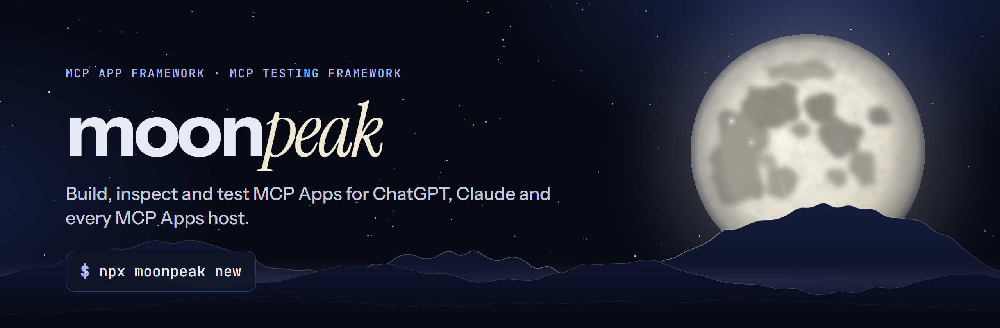
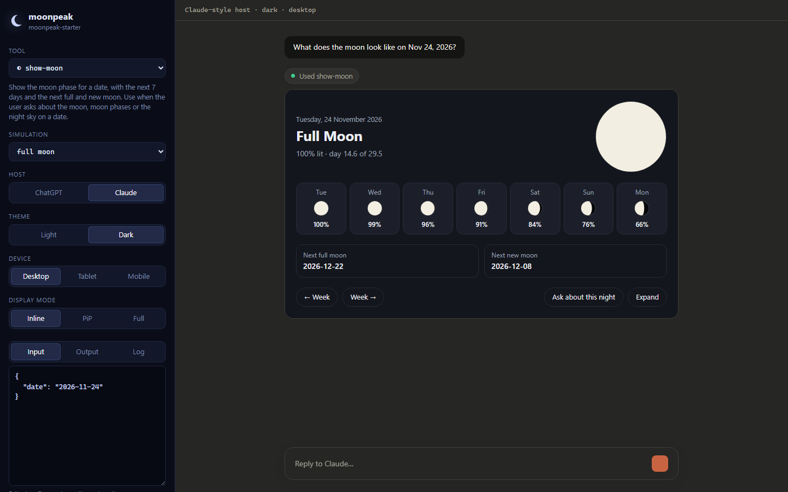

<a href="https://moonpeak-ai.com"></a>

<div align="center">

# moonpeak

[](https://www.npmjs.com/package/moonpeak)
[](https://www.npmjs.com/package/moonpeak)
[](https://github.com/ghiansalman30-crypto/moonpeak/actions/workflows/ci.yml)
[](https://github.com/ghiansalman30-crypto/moonpeak/stargazers)
[](./LICENSE)
[](./packages/moonpeak/types)
[](https://react.dev)
[](https://github.com/modelcontextprotocol/ext-apps)
[](https://moonpeak-ai.com/docs/)

**Server-agnostic MCP testing framework and full-stack MCP App framework.**

```bash
npx moonpeak new
```

[Website](https://moonpeak-ai.com) · [Live demo server](https://moonpeak-ai.com/mcp) · [Documentation](https://moonpeak-ai.com/docs/) · [Blog](https://moonpeak-ai.com/blog/) · [npm](https://www.npmjs.com/package/moonpeak) · [GitHub](https://github.com/ghiansalman30-crypto/moonpeak)

</div>

<p align="center"></p>

## Why moonpeak

MCP Apps are MCP tools that come with a UI. The host (ChatGPT, Claude, VS Code, Goose...) fetches a `ui://` resource and renders it in a sandboxed frame next to the conversation. Building one usually means juggling a server, a bundler, a fake host to look at it and a way to test it without burning AI credits. moonpeak is all of that in one package:

- **One file per tool, one folder per View.** No config file, no host-specific forks.
- **A local inspector** with ChatGPT-style and Claude-style hosts, so you can see your View without an account, a tunnel or a model.
- **Tests that run in CI** in about a second, plus Playwright e2e and real-model evals when you want them.
- **Built on the official SDKs** (`@modelcontextprotocol/ext-apps` and the MCP TypeScript SDK v2), so what works in the inspector works in real hosts.

## moonpeak has three use cases

### 1. App Framework

```bash
npx moonpeak new my-app            # asks which resources you want
npx moonpeak new my-app calendar,review
cd my-app && npm run dev           # inspector at http://localhost:3000, MCP server at /mcp
```

The starter ships three resources you can pick from:

| Resource | Pattern | What it does |
|---|---|---|
| `moon` | detail card | moon phase for a date, a 7-day strip, calls tools from the View |
| `calendar` | carousel | swipeable cards of the upcoming phases, loads more through the host |
| `review` | review / confirm | the model proposes a stargazing night, the user confirms it in the UI through an app-only tool |

```ts
// src/tools/show-moon.ts
export const tool = { title: "Show moon phase", description: "...", resource: "moon" };
export const schema = { date: z.string().optional() };
export default async function ({ date }) {
  return { phase: "Full Moon", illumination: 1 };   // becomes structuredContent
}
```

```tsx
// src/resources/moon/moon.tsx
import { useToolData, useTheme, useCallTool } from "moonpeak";

export default function Moon() {
  const { output, isPending } = useToolData();
  return isPending ? <p>Loading…</p> : <h1 className={useTheme()}>{output.phase}</h1>;
}
```

27 hooks cover tool data, theme, display modes, locale, safe areas, per-View state, calling tools, posting messages and updating model context. ChatGPT and Claude extras live behind `moonpeak/chatgpt` and `moonpeak/claude`.

`moonpeak build` inlines each View into a single HTML file and bundles your tools. Serve it with `moonpeak start`, or mount `createHandler` from `moonpeak/server` on Workers, Hono, Express, Deno or Bun.

### 2. Testing Framework

```bash
moonpeak test                     # schemas, Views and simulations, in-process, ~1s
moonpeak test --e2e               # Playwright against the inspector
moonpeak test --visual            # screenshot tests
moonpeak test --eval              # do real models pick the right tool?
moonpeak test --server <url>      # test any MCP server, in any language
moonpeak test init --server <url> # write simulations for an existing server
```

Simulations are JSON fixtures: tool input, optional mocked output, expectations and host settings. E2E tests get `inspector` and `mcp` fixtures from `moonpeak/test`.

### 3. Inspector

```bash
moonpeak dev                                           # your project, with hot reload
moonpeak inspect --server https://moonpeak-ai.com/mcp  # any MCP server
```

Switch host (ChatGPT / Claude), theme, device width and display mode (inline, PiP, fullscreen). Edit tool input and output live. Every setting lives in the URL, so a bug report is a link.

## Try it in a real host

The starter app runs at **https://moonpeak-ai.com/mcp**. Add it as a custom connector in Claude (Settings → Connectors) or as an app in ChatGPT developer mode, then ask *"what does the moon look like on Nov 24?"*.

## Resources

- [Documentation](https://moonpeak-ai.com/docs/) (78 pages, also as [llms.txt](https://moonpeak-ai.com/docs/llms.txt)) and the [package README](./packages/moonpeak/README.md)
- [Blog](https://moonpeak-ai.com/blog/): tutorials and release notes
- [Starter example](./examples/starter) · [Kitchen sink](./examples/kitchen-sink) (every hook, for testing hosts)
- [Agent skill](./skills/moonpeak/SKILL.md) for Claude Code and other coding agents
- [MCP Apps specification](https://github.com/modelcontextprotocol/ext-apps)

## Repository

```
packages/moonpeak      the framework, CLI, inspector and test runner (published to npm)
examples/starter       the template behind `moonpeak new`
examples/kitchen-sink  every hook and host action, used by the inspector checks
site/                  moonpeak-ai.com landing page and docs
skills/                agent skill for building moonpeak apps
```

```bash
npm install
npx playwright install chromium
npm run validate        # typecheck, tests, builds and e2e for every example
```

## About

moonpeak is open source under the [MIT license](./LICENSE). It has no token and no telemetry. Contributions are welcome: open an issue or a pull request, and run `npm run validate` before you push.
